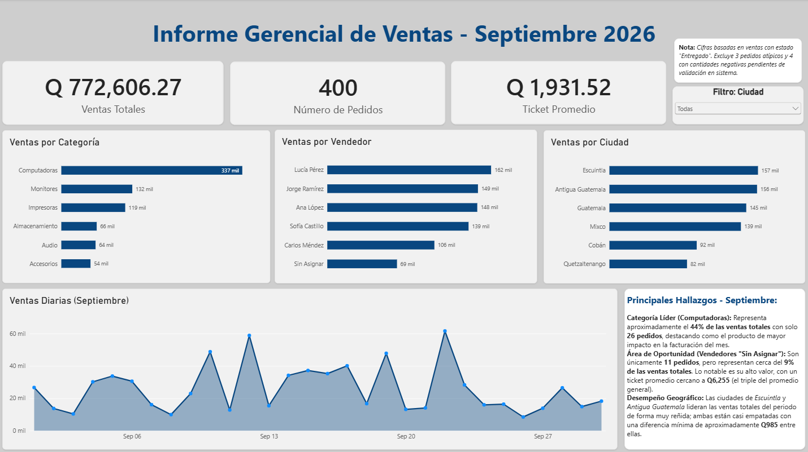

# Caso 1: Análisis de ventas de septiembre 2026

> Caso práctico con **datos simulados**.

## Contexto
Una tienda de tecnología entrega un archivo con sus ventas de septiembre. 
El jefe pide las ventas totales, la categoría líder, el mejor vendedor y el desempeño por ciudad, 
y que se le avise si algo en los datos no cuadra. 

## Preguntas de negocio
1. ¿Cuáles fueron las ventas totales?
2. ¿Qué categoría vendió más?
3. ¿Quién fue el mejor vendedor?
4. ¿Cómo le fue a cada ciudad?

## Herramientas
Excel · MySQL · Power BI

## Proceso
1. Limpieza de datos en Excel
2. Carga en MySQL
3. Consultas SQL
4. Dashboard en Power BI
5. Informe al jefe

## Problemas encontrados en los datos

| Problema | Filas | Acción |
|---|---|---|
| `id_pedido`: pedidos duplicados | 12 | Eliminados; quedaron 520 pedidos únicos |
| `fecha`: tres formatos mezclados | 520 | Convertidas a aaaa-mm-dd; rango validado del 1 al 30 de septiembre |
| `cliente`: celdas vacías | 18 | Etiquetadas como "Desconocido" |
| `ciudad`: mayúsculas, espacios y abreviatura "Guate" | 60 | Unificadas en 6 ciudades |
| `categoria`: texto en minúsculas | 25 | Unificadas en 6 categorías |
| `cantidad`: 4 negativas y 3 atípicas (250 a 999 unidades) | 7 | Marcadas con `es_cantidad_negativa` y `es_atipico`; excluidas del cálculo, no eliminadas |
| `precio_unitario`: texto con "Q" y comas | 30 | Convertido a número |
| `descuento_pct`: celdas vacías | 25 | Reemplazadas por 0 % (supuesto) |
| `estado`: mayúsculas y espacios ocultos | 20 | Unificados en 3 estados; 4 pedidos con espacio oculto dejaban fuera Q2,615.80 |
| `vendedor`: celdas vacías | 14 | Etiquetados como "Sin Asignar" |

## Resultados principales
- Ventas totales: Q772,606.27 en 400 pedidos entregados
- Ticket promedio: Q1,931.52
- Categoría líder: computadoras con 44% de las ventas
- Mejor vendedor: Lucía Pérez encabeza con Q162 mil
- Ciudades: Escuintla (Q157 mil) y Antigua Guatemala (Q156 mil) casi empatadas; 
las de menor venta son Cobán (Q92 mil) y Quetzaltenango (Q82 mil).

## Dashboard

## Aprendizajes
- 4 pedidos tenían un espacio oculto en `estado` y quedaban fuera de las ventas (Q2,615.80). Ahora reviso los espacios en todas las columnas de texto.
- Excel, con configuración regional de EE. UU., interpretó algunas fechas con el día y el mes invertidos. Lo resolví importando el archivo como texto y validando que el rango fuera del 1 al 30 de septiembre.
- Tres pedidos de 250 a 999 unidades contrastaban con los pedidos normales de 1 a 5. Los marqué como atípicos y los excluí del cálculo hasta validarlos.
- Workbench mostraba las fechas un día antes. Comparé con `DATE_FORMAT` y con el archivo original para confirmar que los datos estaban bien: cuando dos herramientas no coinciden, busco una tercera fuente.

## Archivos
- `consultas.sql`: las consultas del análisis
- `ventas_limpias.csv`: datos limpios
- `anexo_depuracion.pdf`: detalle de la limpieza
- `dashboard.pdf`: dashboard en PDF
