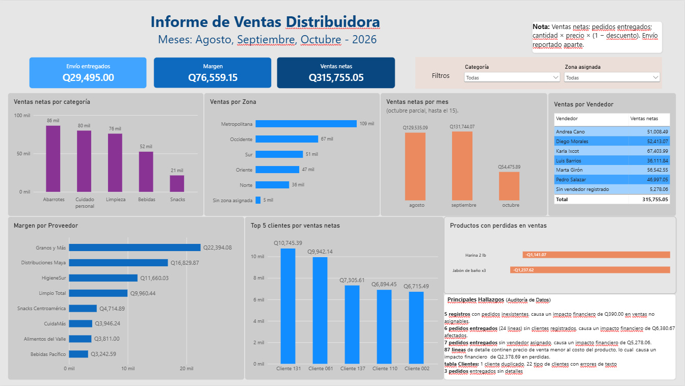

# Caso 2: Análisis de ventas de una distribuidora (agosto a octubre 2026)

> Caso práctico con **datos simulados**.

## Contexto
Una distribuidora de abarrotes entrega sus datos en **6 tablas relacionadas** (clientes, pedidos, detalle de pedidos, productos, proveedores y vendedores). El gerente comercial pide ventas, margen, mejores clientes, rendimiento por vendedor y zona, y que se avise de los registros que no cuadran entre tablas.

## Preguntas de negocio
1. Ventas netas totales y por mes
2. Ventas por categoría y por tipo de cliente
3. Los 5 mejores clientes
4. Margen por proveedor y productos que se venden con pérdida
5. Ventas por vendedor y por zona
6. Clientes que nunca compraron y productos que nunca se vendieron
7. Costo de envío de los pedidos entregados
8. Registros que no cuadran entre tablas y su efecto en los totales

## Herramientas
MySQL (JOINs, LEFT JOIN, auditoría de integridad) · Power BI conectado directo a MySQL (modelo con relaciones y medidas DAX)

## Proceso
1. Carga de los 6 archivos con `LOAD DATA INFILE`; tabla temporal para inspeccionar el duplicado antes de pasarlo a la tabla definitiva.
2. Auditoría de integridad entre tablas con `LEFT JOIN ... IS NULL`.
3. Consultas SQL de las 8 preguntas, definiendo ventas netas como cantidad × precio × (1 − descuento) en pedidos entregados.
4. Modelo en Power BI con relaciones, medidas DAX y dashboard.
5. Verificación: las cifras del dashboard coinciden con las de las consultas SQL.

## Problemas encontrados
| Problema | Casos | Efecto | Tratamiento |
|---|---|---|---|
| Cliente duplicado | 1 cliente (2 filas idénticas) | Violaba la llave primaria al cargar | Cargado sin repetir |
| `tipo_cliente` mal escrito | 22 filas | Separaba un mismo tipo en varios grupos | Estandarizado |
| Pedidos con cliente inexistente | 8 (6 entregados, 24 líneas) | Q6,380.67 sin cliente identificable | Se mantienen y se rotulan "Sin cliente registrado" |
| Pedidos sin vendedor | 10 (7 entregados) | Q5,278.06 sin vendedor ni zona | Se rotulan "Sin vendedor registrado" |
| Líneas de detalle con pedido inexistente | 5 | Q390.00 que no se pueden asignar a ningún estado | Excluidas de las ventas |
| Pedidos entregados sin detalle | 3 | No aportan venta visible | Reportados |
| Productos con costo mayor al precio de lista | 2 (Harina 2 lb, Jabón de baño x3) | 87 líneas vendidas con pérdida, Q2,378.69 | Reportado, pendiente de validar con compras |

## Resultados principales
- Ventas netas: **Q315,755.05** (agosto Q129,535.09; septiembre Q131,744.07; octubre Q54,475.89, con datos hasta el 15).
- Margen: **Q76,559.15**. Mayor aporte: Granos y Más (Q22,394.08).
- Categoría líder: Abarrotes (Q86,268.17). Zona líder: Metropolitana (Q108,955.62).
- Mejor cliente: Cliente 131 (Q10,745.39). Mejor vendedora: Karla Ixcot (Q67,403.99).
- Envío de pedidos entregados: Q29,495.00, reportado aparte porque los datos no indican si es un gasto o un cobro al cliente. Pendiente de validar.

## Dashboard

## Aprendizajes
- Un `JOIN` interno puede descartar ventas sin avisar. Conviene comprobar que los desgloses sumen el total.
- Un campo vacío (`NULL`) no es lo mismo que un ID que no existe.
- Un dato que está a nivel de pedido, como el envío, se infla si se suma después de unir con el detalle.
- Verificar el dashboard contra las consultas SQL asegura que las cifras sean confiables.

## Archivos
- `consultas.sql`: consultas de las 8 preguntas
- `dashboard.pdf`: dashboard en PDF
